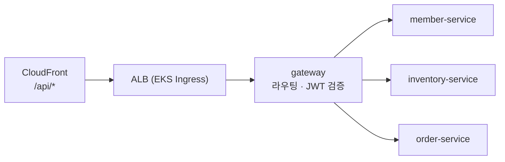

# gateway

> FreshLink의 **모든 API 요청이 지나가는 입구**. 요청을 알맞은 서비스로 보내고(라우팅), 로그인 토큰(JWT)이 진짜인지 확인한다.

| 항목 | 내용 |
| --- | --- |
| 담당 | 김진아 |
| 관련 기능 ID | C-03 역할별 권한 분리 |
| 기술 | Java 21, Spring Boot 3, Spring Cloud Gateway |
| 배포 | GitHub Actions → ECR `freshlink/gateway` → ArgoCD → EKS (`freshlink` 네임스페이스, 파드 2개) |

---

## 1. FreshLink는 무엇인가

편의점 점주와 고객이 **같은 재고 데이터**를 보는 서비스다. 고객이 결제하면 점주 화면의 재고가 정확하게 줄고, 유통기한이 지난 상품은 고객에게 팔리지 않는다. 전체 소개는 [Organization README](https://github.com/sesac-freshlink)를 참고한다.

## 2. 아키텍처에서의 위치



사용자는 CloudFront 주소 하나로 접속한다. 화면은 S3에서, `/api/*` 요청은 ALB를 거쳐 이 게이트웨이로 들어온다. 게이트웨이는 **DB를 갖지 않는다.** 서명 키만 있으면 토큰을 검증할 수 있기 때문이다.

> 비유: member-service가 놀이공원 매표소(신분 확인 후 손목띠 채우기)라면, gateway는 놀이기구 입구 직원(손목띠가 진짜인지, 오늘 날짜인지만 확인)이다.

## 3. 하는 일

1. **라우팅**

   | 경로 | 보내는 곳 |
   | --- | --- |
   | `/api/members/**`, `/api/auth/**`, `/api/stores` | member-service |
   | `/api/owner/inventory/**`, `/api/stores/{id}/products`, `/api/owner/disposals` | inventory-service |
   | `/api/orders/**`, `/api/owner/orders` | order-service |

2. **공개 경로 예외:** 회원가입, 로그인, 점포 검색, 점포 상품 목록은 토큰 없이 통과시킨다.
3. **토큰 검증:** 서명이나 만료가 잘못되면 `401`.
4. **역할 1차 확인:** `/api/owner/**`는 `OWNER`만 통과, 아니면 `403`.
5. **사용자 정보 전달:** 토큰에서 꺼낸 값을 `X-User-Id`, `X-User-Role`, `X-Store-Id` 헤더로 붙여 넘긴다.
6. **위조 헤더 제거:** 클라이언트가 보낸 `X-User-*`, `X-Store-Id`는 **먼저 지우고** 다시 채운다. 빠뜨리면 다른 사람인 척 요청할 수 있다.

'이 lot이 내 점포 것인가', '이 주문이 내 주문인가' 같은 **소유권 확인은 각 서비스가** 헤더와 DB를 비교해서 한다.

### JWT 규칙 (member-service와 공동 결정)

| 항목 | 값 |
| --- | --- |
| 서명 | HS256, 비밀 키 하나를 member-service와 공유 (Kubernetes Secret) |
| 담는 정보 | `userId`, `role`(OWNER/CUSTOMER), `storeId`(점주만), `exp` |
| 만료 | 1시간, 리프레시 토큰 없음 |

## 4. 폴더 구조

```
gateway/
├── src/main/java/com/freshlink/gateway/
│   ├── config/      # 라우팅 설정
│   ├── filter/      # 위조 헤더 제거, 사용자 헤더 주입 필터
│   └── security/    # JWT 검증, 공개 경로·역할 규칙
├── src/main/resources/application.yml
└── src/test/java/com/freshlink/gateway/
```

## 5. 로컬에서 실행하기

> 아직 뼈대만 있는 상태다. 첫 작업으로 [Spring Initializr](https://start.spring.io)에서 Gradle·Java 21·Spring Cloud Gateway로 프로젝트를 만들고 이 구조에 맞춰 넣는다.

1. [local-dev](https://github.com/sesac-freshlink/local-dev) 레포에서 `docker compose up -d` (MySQL + LocalStack)
2. member-service, inventory-service, order-service를 띄운다
3. 이 레포에서

```bash
export JWT_SECRET=local-dev-secret-at-least-32-bytes-long
./gradlew bootRun
```

`http://localhost:8080/api/...`으로 요청하면 각 서비스로 전달된다.

## 6. 브랜치와 기여

- `main`(배포) ← `dev`(통합, 기본 브랜치) ← `feat/<기능ID>-<설명>` (예: `feat/C-03-role-filter`)
- 커밋·PR 제목: `feat(C-03): 점주 경로 역할 확인`
- PR은 다른 팀원 1명이 승인하면 합친다. 작업 브랜치 → `dev`는 Squash merge, `dev` → `main`은 Merge commit.

자세한 규칙은 [.github 레포](https://github.com/sesac-freshlink/.github)를 참고한다.
