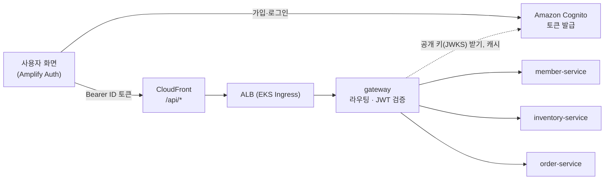

# gateway

> FreshLink의 **모든 API 요청이 지나가는 입구**. 요청을 알맞은 서비스로 보내고(라우팅), Amazon Cognito가 발급한 로그인 토큰(JWT)이 진짜인지 확인한다.

| 항목 | 내용 |
| --- | --- |
| 담당 | 김진아 |
| 관련 기능 ID | C-03 역할별 권한 분리 |
| 기술 | Java 21, Spring Boot 3, Spring Cloud Gateway, Spring Security OAuth2 Resource Server (Cognito JWKS, RS256) |
| 관측성 | Actuator·Micrometer → Prometheus (앱 포트의 `/actuator/prometheus`, 관리 포트를 따로 두지 않는다. 쿠버네티스에서는 모든 컨테이너가 8080) · Micrometer Tracing → Zipkin · JSON 로그(traceId 포함) → Alloy → Loki ([gitops/platform/observability](https://github.com/sesac-freshlink/gitops/tree/main/platform/observability)) |
| 배포 | GitHub Actions → ECR `freshlink/gateway` → ArgoCD → EKS (`freshlink` 네임스페이스, 파드 2개) |

---

## 1. FreshLink는 무엇인가

편의점 점주와 고객이 **같은 재고 데이터**를 보는 서비스다. 고객이 결제하면 점주 화면의 재고가 정확하게 줄고, 유통기한이 지난 상품은 고객에게 팔리지 않는다. 전체 소개는 [Organization README](https://github.com/sesac-freshlink)를 참고한다.

## 2. 아키텍처에서의 위치



사용자는 CloudFront 주소 하나로 접속한다. 화면은 S3에서, `/api/*` 요청은 ALB를 거쳐 이 게이트웨이로 들어온다. 게이트웨이는 **DB도, 비밀 키도 갖지 않는다.** Cognito가 개인 키로 서명한 토큰을 Cognito의 공개 키(JWKS)로 검증하기 때문이다.

> 비유: Cognito가 놀이공원 매표소(신분 확인 후 손목띠 채우기)라면, gateway는 놀이기구 입구 직원(손목띠가 진짜인지, 오늘 날짜인지만 확인)이다.

> **변경 (2026-10-13):** 처음에는 member-service가 HS256 JWT를 발급하고 gateway가 같은 비밀 키로 검증하기로 했으나, 발급을 Amazon Cognito로 옮겼다. Keycloak과의 비교와 이유는 [infra/docs/기술스택과 선택이유.md](https://github.com/sesac-freshlink/infra/blob/main/docs/기술스택과%20선택이유.md) 3-7.

## 3. 하는 일

1. **라우팅**

   | 경로 | 보내는 곳 |
   | --- | --- |
   | `/api/members/**`, `/api/stores` | member-service |
   | `/api/owner/inventory/**`, `/api/stores/{id}/products`, `/api/owner/disposals` | inventory-service |
   | `/api/orders/**`, `/api/owner/orders` | order-service |

2. **공개 경로 예외:** 점포 검색, 점포 상품 목록은 토큰 없이 통과시킨다. 회원가입·로그인은 브라우저가 Cognito로 바로 가므로 gateway를 거치지 않는다.
3. **토큰 검증:** Cognito 공개 키(JWKS)로 RS256 서명, 만료(`exp`), 발급자(`iss`), `token_use = id`, `aud`(= 앱 클라이언트 ID)를 확인한다. 하나라도 틀리면 `401`.
4. **역할 1차 확인:** `/api/owner/**`는 `cognito:groups`에 `OWNER`가 있어야 통과, 아니면 `403`.
5. **사용자 정보 전달:** 토큰에서 꺼낸 값을 헤더로 붙여 넘긴다. `sub` → `X-User-Id`, `cognito:groups` → `X-User-Role`, `custom:storeId` → `X-Store-Id`(점주만).
6. **위조 헤더 제거:** 클라이언트가 보낸 `X-User-*`, `X-Store-Id`는 **먼저 지우고** 다시 채운다. 빠뜨리면 다른 사람인 척 요청할 수 있다.
7. **Actuator 보호:** Actuator는 앱 포트(8080)에 있다. `/actuator/**`로 가는 라우트는 만들지 않고, 밖에서 온 `/actuator` 요청은 Spring Security로 막는다(health만 열거나 클러스터 안 요청만 허용). ALB·CloudFront는 `/api/*`만 이 게이트웨이로 넘긴다.

'이 lot이 내 점포 것인가', '이 주문이 내 주문인가' 같은 **소유권 확인은 각 서비스가** 헤더와 DB를 비교해서 한다.

### JWT 규칙 (Cognito ID 토큰)

| 항목 | 값 |
| --- | --- |
| 발급 | Amazon Cognito User Pool `freshlink-users` ([infra](https://github.com/sesac-freshlink/infra) `modules/cognito`) |
| 서명 | RS256. 공개 키는 `https://cognito-idp.ap-northeast-2.amazonaws.com/<UserPoolId>/.well-known/jwks.json`에서 받아 캐시한다. 공유 비밀 키 없음 |
| 보내는 토큰 | 프론트는 **ID 토큰**을 `Authorization: Bearer`로 보낸다. `custom:storeId`는 ID 토큰에만 들어가기 때문이다 |
| 쓰는 클레임 | `sub`(UUID), `cognito:groups`(OWNER/CUSTOMER), `custom:storeId`(점주만), `token_use`(= `id`), `aud`(= 앱 클라이언트 ID), `iss`, `exp` |
| 만료 | ID 토큰 1시간, 리프레시 토큰 1일 (갱신은 프론트의 Amplify가 한다) |

`X-User-Id`는 숫자가 아니라 UUID 문자열이다. 뒤 서비스는 사용자 ID 칸을 `VARCHAR(36)`으로 둔다.

Spring 설정은 이 정도면 된다. 공개 키를 받으러 밖으로 나가므로 파드가 NAT를 통해 Cognito에 닿아야 한다.

```yaml
spring:
  security:
    oauth2:
      resourceserver:
        jwt:
          issuer-uri: ${COGNITO_ISSUER_URI}   # https://cognito-idp.ap-northeast-2.amazonaws.com/<UserPoolId>
```

## 4. 폴더 구조

```
gateway/
├── src/main/java/com/freshlink/gateway/
│   ├── config/      # 라우팅 설정
│   ├── filter/      # 위조 헤더 제거, 사용자 헤더 주입 필터
│   └── security/    # Cognito JWT 검증(Resource Server), 공개 경로·역할 규칙
├── src/main/resources/application.yml
└── src/test/java/com/freshlink/gateway/
```

## 5. 로컬에서 실행하기

> 아직 뼈대만 있는 상태다. 첫 작업으로 [Spring Initializr](https://start.spring.io)에서 Gradle·Java 21·Spring Cloud Gateway로 프로젝트를 만들고 이 구조에 맞춰 넣는다.

1. [local-dev](https://github.com/sesac-freshlink/local-dev) 레포에서 `docker compose up -d` (MySQL + LocalStack)
2. member-service, inventory-service, order-service를 띄운다
3. 이 레포에서

```bash
export COGNITO_ISSUER_URI=https://cognito-idp.ap-northeast-2.amazonaws.com/<개발용 UserPoolId>
export COGNITO_CLIENT_ID=<앱 클라이언트 ID>
./gradlew bootRun
```

`http://localhost:8080/api/...`으로 요청하면 각 서비스로 전달된다. Cognito는 LocalStack 무료판에서 흉내 낼 수 없으므로 로컬에서도 개발용 User Pool(Terraform 유지 묶음, 항상 켜져 있음)을 그대로 쓴다. 토큰은 프론트에서 로그인하거나 `aws cognito-idp initiate-auth`로 받는다.

## 6. 브랜치와 기여

- `main`(배포) ← `dev`(통합, 기본 브랜치) ← `feat/<기능ID>-<설명>` (예: `feat/C-03-role-filter`)
- 커밋·PR 제목: `feat(C-03): 점주 경로 역할 확인`
- PR·승인은 필수가 아니다. 담당자가 `dev`·`main`에 직접 push해도 된다. PR을 쓸 때는 작업 브랜치 → `dev`는 Squash merge, `dev` → `main`은 Merge commit.

자세한 규칙은 [.github 레포](https://github.com/sesac-freshlink/.github)를 참고한다.
