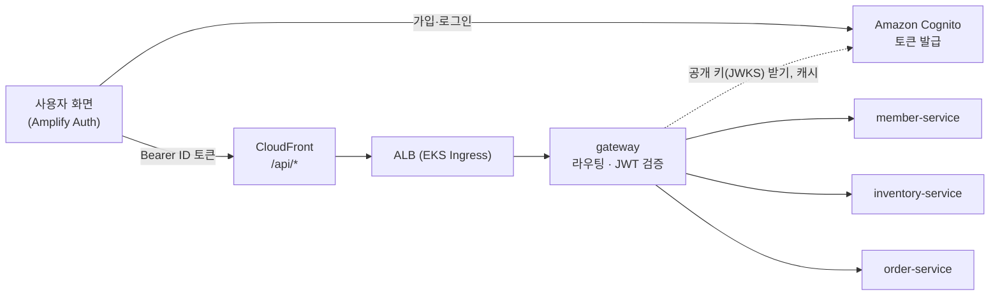

# gateway

> FreshLink의 **모든 API 요청이 지나가는 입구**. 요청을 알맞은 서비스로 보내고(라우팅), Amazon Cognito가 발급한 로그인 토큰(JWT)이 진짜인지 확인한다.

| 항목 | 내용 |
| --- | --- |
| 담당 | 김진아 |
| 관련 기능 ID | C-03 역할별 권한 분리 |
| 기술 | Java 21, Spring Boot 4.0.x, Spring Cloud Gateway **WebMVC**(서블릿판, Spring Cloud 2025.1.x), Spring Security OAuth2 Resource Server (Cognito JWKS, RS256) |
| 관측성 | Actuator·Micrometer → Prometheus (앱 포트의 `/actuator/prometheus`, 관리 포트를 따로 두지 않는다. 모든 서비스가 8080) · Micrometer Tracing → Zipkin · JSON 로그(traceId 포함) → Alloy → Loki ([gitops/platform/observability](https://github.com/sesac-freshlink/gitops/tree/main/platform/observability)) |
| 배포 | GitHub Actions → ECR `gateway` → gitops → ArgoCD → EKS (`freshlink` 네임스페이스, 파드 2개) |

---

## 1. FreshLink는 무엇인가

편의점 점주와 고객이 **같은 재고 데이터**를 보는 서비스다. 고객이 결제하면 점주 화면의 재고가 정확하게 줄고, 유통기한이 지난 상품은 고객에게 팔리지 않는다. 전체 소개는 [Organization README](https://github.com/sesac-freshlink)를 참고한다.

## 2. 아키텍처에서의 위치



사용자는 CloudFront 주소 하나로 접속한다. 화면은 S3에서, `/api/*` 요청은 ALB를 거쳐 이 게이트웨이로 들어온다. 게이트웨이는 **DB도, 비밀 키도 갖지 않는다.** Cognito가 개인 키로 서명한 토큰을 Cognito의 공개 키(JWKS)로 검증하기 때문이다.

> 비유: Cognito가 놀이공원 매표소(신분 확인 후 손목띠 채우기)라면, gateway는 놀이기구 입구 직원(손목띠가 진짜인지, 오늘 날짜인지만 확인)이다.

> **변경 (2026-10-13):** 처음에는 member-service가 HS256 JWT를 발급하고 gateway가 같은 비밀 키로 검증하기로 했으나, 발급을 Amazon Cognito로 옮겼다. Keycloak과의 비교와 이유는 [.github docs/기획/기술스택과-선택이유.md](https://github.com/sesac-freshlink/.github/blob/main/docs/기획/기술스택과-선택이유.md) 3-7.

## 3. 하는 일

1. **라우팅** (`application.yml`, 위에서부터 먼저 매칭. 모두 `/api`를 떼고 넘긴다)

   | 순서 | 경로 | 메서드 | 보내는 곳 | 인증 | 역할 (아니면 403) |
   | --- | --- | --- | --- | --- | --- |
   | 1 | `/api/stores/{storeId}/products`, `/api/stores/{storeId}/products/{productId}` | GET | inventory-service | 공개 | |
   | 2 | `/api/stores`, `/api/stores/{storeId}` | GET | member-service | 공개 | |
   | 3 | `/api/members/nickname-availability` | GET | member-service | 공개 | |
   | 4 | `/api/members/**` | 전부 | member-service | 로그인 | |
   | 5 | `/api/admin/**` | 전부 | member-service | 로그인 | ADMIN |
   | 6 | `/api/owner/inventory/**`, `/api/owner/disposals` | 전부 | inventory-service | 로그인 | OWNER |
   | 7 | `/api/owner/orders/**` | 전부 | order-service | 로그인 | OWNER |
   | 8 | `/api/orders/**` | 전부 | order-service | 로그인 | CUSTOMER |
   | 9 | `/api/notifications/**` | 전부 | notification-service | 로그인 | (서비스가 고객·점주를 나눈다) |
   | - | `/ops/**`, 그 밖의 경로 | - | 라우트 없음 | 막음 | |

   `/api/owner/orders/**`에는 목록·픽업 확인(`POST /api/owner/orders/{orderId}/pickup`)·매출(`/sales`)·매출 SSE(`/sales/stream`)가 들어간다. SSE(`text/event-stream`)는 gateway가 모으지 않고 받는 대로 넘기고, 서비스로 가는 읽기 타임아웃도 없다(따로 설정할 것 없음, `application.yml` 주석). 화면 알림 SSE(`/api/notifications/stream`)도 같다. 서비스는 20초마다 heartbeat를 보낸다(CloudFront origin 응답 타임아웃 30초·ALB 유휴 타임아웃 60초에 끊기지 않게).

   서비스 주소는 기본값이 쿠버네티스 Service 이름(`http://member-service:8080` 등)이고, `MEMBER_SERVICE_URI`·`INVENTORY_SERVICE_URI`·`ORDER_SERVICE_URI`·`NOTIFICATION_SERVICE_URI`로 바꿀 수 있다. `Idempotency-Key`·`Authorization` 같은 다른 헤더는 그대로 넘긴다.

2. **공개 경로 예외:** 위 표의 GET 경로(1·2·3번)와 아래 "로그인(BFF)" 표에서 공개로 적은 `/api/auth/*`만 토큰 없이 통과시킨다. 같은 경로라도 GET이 아니면 로그인이 필요하다.
3. **토큰 찾기:** `Authorization: Bearer` 헤더가 있으면 그것을, 없으면 `fl_id` 쿠키를 쓴다. 로그인·갱신 같은 `/api/auth/*` 요청에는 쿠키를 보지 않는다(`/api/auth/me`만 본다). 만료된 쿠키 때문에 로그인 요청이 401로 막히지 않게 하려는 것이다.
4. **CSRF 확인:** `/api/**`로 오는 POST·PUT·PATCH·DELETE는 `X-Requested-With: freshlink` 헤더가 있어야 한다. 없으면 `403` `{"code":"CSRF_HEADER_REQUIRED",...}`. 쿠키는 다른 사이트에서도 따라오지만 이 헤더는 다른 사이트가 붙일 수 없다(브라우저가 사전 요청으로 막는다).
5. **토큰 검증:** Cognito 공개 키(JWKS)로 RS256 서명, 만료(`exp`), 발급자(`iss`), `token_use = id`, `aud`(= 앱 클라이언트 ID)를 확인한다. 하나라도 틀리면 `401`.
6. **역할 1차 확인:** `/api/owner/**`는 `cognito:groups`에 `OWNER`, `/api/admin/**`는 `ADMIN`, `/api/orders/**`는 `CUSTOMER`가 있어야 통과, 아니면 `403`.
7. **사용자 정보 전달:** 토큰에서 꺼낸 값을 헤더로 붙여 넘긴다. `sub` → `X-User-Id`, `cognito:groups` → `X-User-Role`(`OWNER`·`CUSTOMER`·`ADMIN`만 남기고 쉼표로 잇는다. 구글 로그인 사용자에게 Cognito가 자동으로 넣는 `<UserPoolId>_Google` 그룹은 뺀다), `custom:storeId` → `X-Store-Id`(값이 있을 때만).
8. **위조 헤더 제거:** 클라이언트가 보낸 `X-User-*`, `X-Store-Id`는 **먼저 지우고** 다시 채운다. 빠뜨리면 다른 사람인 척 요청할 수 있다.
9. **Actuator 보호:** Actuator는 앱 포트(8080)에 있다. `/actuator/**`로 가는 라우트는 만들지 않는다. ALB·CloudFront를 거친 요청(`X-Forwarded-For` 헤더가 있음)은 `/actuator`를 막고(401), 클러스터 안 요청(probe, Prometheus, ALB 상태 확인)만 허용한다. ALB Ingress는 `/api`만 이 게이트웨이로 넘긴다.

401·403 본문은 서비스와 같은 모양이다: `{"code":"UNAUTHORIZED","message":"로그인이 필요합니다","traceId":null}`, `{"code":"FORBIDDEN","message":"권한이 없습니다","traceId":null}`. `traceId`는 할 일 16(Micrometer Tracing → Zipkin)에서 채워진다.

'이 lot이 내 점포 것인가', '이 주문이 내 주문인가' 같은 **소유권 확인은 각 서비스가** 헤더와 DB를 비교해서 한다.

### 로그인(BFF) (2026-10-29)

브라우저는 Cognito에 직접 가지 않고 gateway의 `/api/auth/*`를 부른다. gateway가 시크릿이 있는 `bff` 앱 클라이언트로 Cognito에 대신 요청하고, 받은 토큰을 브라우저 자바스크립트가 읽을 수 없는 쿠키(HttpOnly)에 넣는다. 설계와 이유는 [.github docs/인수인계/BFF.md](https://github.com/sesac-freshlink/.github/blob/main/docs/인수인계/BFF.md)가 기준이다.

| 경로 | 메서드 | 인증 | 하는 일 | 응답 |
| --- | --- | --- | --- | --- |
| `/api/auth/login` | POST | 공개 | `{email, password}`로 AdminInitiateAuth(ADMIN_USER_PASSWORD_AUTH) | `200` 사용자 정보 `{userId, role, storeId, email}` + 쿠키 3개 |
| `/api/auth/signup` | POST | 공개 | `{email, password}`로 SignUp. 인증 코드 메일이 간다 | `201` |
| `/api/auth/confirm` | POST | 공개 | `{email, code}`로 ConfirmSignUp. 그룹은 가입 확인 Lambda가 넣는다 | `204` |
| `/api/auth/refresh` | POST | 공개(쿠키) | `fl_refresh`·`fl_uid`로 REFRESH_TOKEN_AUTH | `200` + 새 `fl_id`. 실패하면 `401` + 쿠키 지움 |
| `/api/auth/logout` | POST | 공개(쿠키) | RevokeToken(실패해도 진행) | `204` + 쿠키 지움 |
| `/api/auth/me` | GET | 로그인 | `fl_id` 토큰의 사용자 정보 | `200` 사용자 정보 |
| `/api/auth/google` | GET | 공개 | PKCE(S256)·state를 만들어 Cognito 호스팅 UI(`identity_provider=Google`)로 보낸다 | `302` + `fl_oauth` 쿠키 |
| `/api/auth/callback` | GET | 공개 | state 확인 → `/oauth2/token`으로 코드 교환 → ID 토큰 검증 → 쿠키 | `302` 화면 첫 페이지. 실패하면 `302 /login?error=google`, state가 틀리면 `400` |

| 쿠키 | 값 | Path | SameSite | 만료 |
| --- | --- | --- | --- | --- |
| `fl_id` | ID 토큰 | `/api` | Strict | 토큰 만료(`expires_in`, 1시간) |
| `fl_refresh` | 리프레시 토큰 | `/api/auth` | Strict | 1일 (`refresh-token-validity`) |
| `fl_uid` | `cognito:username` (갱신 때 SECRET_HASH에 필요) | `/api/auth` | Strict | 1일 |
| `fl_oauth` | `state.verifier` (구글 로그인 중에만) | `/api/auth` | Lax | 10분 |

- 모든 쿠키는 HttpOnly·Secure이고 Domain을 붙이지 않는다. 화면과 API가 같은 CloudFront 주소라서 SameSite=Strict로도 따라온다. `fl_oauth`만 Lax인 것은 구글에서 돌아오는 요청이 다른 사이트에서 오는 이동이기 때문이다.
- SECRET_HASH = Base64(HMAC-SHA256(시크릿, 사용자 이름 + bff 클라이언트 ID)). 로그인·가입·확인은 이메일, 갱신은 `fl_uid` 값을 사용자 이름으로 쓴다.
- 오류 본문은 `{code, message, traceId}`다. 코드: `INVALID_CREDENTIALS`(401), `USER_NOT_CONFIRMED`·`PASSWORD_RESET_REQUIRED`·`CHALLENGE_REQUIRED`(403), `EMAIL_ALREADY_EXISTS`(409), `INVALID_PASSWORD`·`INVALID_REQUEST`·`CODE_MISMATCH`·`CODE_EXPIRED`·`INVALID_OAUTH_STATE`(400), `SESSION_EXPIRED`(401), `TOO_MANY_REQUESTS`(429), `AUTH_UNAVAILABLE`(502).
- 이메일로 이미 가입한 사람이 같은 이메일로 구글 로그인하면 Cognito에는 구글 사용자가 따로 생긴다. 이 계정의 프로필 등록(MB-02)은 member-service가 `409 EMAIL_SIGNUP_EXISTS`로 막는다(gateway에는 사용자 목록 조회 권한이 없다).
- 시크릿·토큰 원문은 로그에 남기지 않는다.

### JWT 규칙 (Cognito ID 토큰)

| 항목 | 값 |
| --- | --- |
| 발급 | Amazon Cognito User Pool `freshlink-users` ([infra](https://github.com/sesac-freshlink/infra) `modules/cognito`) |
| 서명 | RS256. 공개 키는 `https://cognito-idp.ap-northeast-2.amazonaws.com/<UserPoolId>/.well-known/jwks.json`에서 받아 캐시한다. 공유 비밀 키 없음 |
| 보내는 토큰 | **ID 토큰**을 쓴다. `custom:storeId`는 ID 토큰에만 들어가기 때문이다. 브라우저는 `fl_id` 쿠키로 보내고, 헤더(`Authorization: Bearer`)로 보내도 받는다 |
| 쓰는 클레임 | `sub`(UUID), `cognito:groups`(OWNER/CUSTOMER), `custom:storeId`(점주만), `token_use`(= `id`), `aud`(= 앱 클라이언트 ID), `iss`, `exp` |
| 만료 | ID 토큰 1시간, 리프레시 토큰 1일 (갱신은 프론트가 401을 받으면 `POST /api/auth/refresh`를 부른다) |

`X-User-Id`는 숫자가 아니라 UUID 문자열이다. 뒤 서비스는 사용자 ID 칸을 `VARCHAR(36)`으로 둔다.

설정은 환경 변수로 받는다. 클러스터에서는 infra가 ArgoCD root에 넘긴 값과 External Secrets가 만든 시크릿을 파드에 넣는다. 공개 키는 첫 요청 때 받아 캐시하므로 Cognito에 닿지 않아도 기동은 된다(파드는 NAT를 통해 Cognito에 닿는다).

```yaml
freshlink:
  cognito:
    issuer-uri: ${COGNITO_ISSUER_URI}         # https://cognito-idp.ap-northeast-2.amazonaws.com/<UserPoolId>
    client-id: ${COGNITO_CLIENT_ID}           # 토큰 aud와 같아야 한다 (dev는 bff 클라이언트)
    bff-client-id: ${COGNITO_BFF_CLIENT_ID}   # 로그인·갱신·가입에 쓰는 bff 클라이언트
    client-secret: ${COGNITO_CLIENT_SECRET}   # bff 클라이언트 시크릿. 파일·로그에 쓰지 않는다
    user-pool-id: ${COGNITO_USER_POOL_ID}
    domain-url: ${COGNITO_DOMAIN_URL}         # 구글 로그인용 Cognito 호스팅 UI 주소
    region: ${AWS_REGION}
  frontend-url: ${FRONTEND_URL}               # 구글 콜백 redirect_uri(<FRONTEND_URL>/api/auth/callback)와 로그인 뒤 돌아갈 곳
```

> **prod 주의:** 화면이 BFF로 바뀐 뒤에는 prod의 `COGNITO_CLIENT_ID`도 bff 클라이언트여야 한다. BFF 없이 main에 릴리스하거나 그 반대가 되면 prod 로그인이 깨진다.

## 4. 폴더 구조

```
gateway/
├── build.gradle                       # Boot 4.0.8, Spring Cloud 2025.1.3, Gateway WebMVC + Actuator, Cognito SDK(spring-cloud-aws BOM 4.2.0)
├── .github/workflows/ci.yml          # CI 호출부 (.github 레포 spring-build.yml)
├── src/main/java/com/freshlink/gateway/
│   ├── GatewayApplication.java
│   ├── auth/        # 로그인(BFF): AuthController(/api/auth/*), CognitoAuthService(Cognito 호출·SECRET_HASH), AuthCookies(쿠키 규칙)
│   ├── filter/UserHeaderFilter.java   # 위조 헤더 제거, 사용자 헤더 주입(역할 그룹만)
│   └── security/    # SecurityConfig(공개 경로·역할 규칙), CognitoJwtValidators(iss·token_use·aud), CognitoProperties,
│                    #   CookieBearerTokenResolver(헤더 → fl_id 쿠키), CsrfHeaderFilter(X-Requested-With)
├── src/main/resources/
│   ├── application.yml                # 라우팅 표, Cognito 값(환경 변수)
│   ├── application-dev.yml            # 로그 레벨만 다름
│   └── application-prod.yml
└── src/test/java/com/freshlink/gateway/
    ├── GatewayApplicationTests.java   # 가짜 Cognito(JWKS)·가짜 서비스로 401·403·라우팅·위조 헤더 제거·CSRF·쿠키 토큰 확인
    └── AuthControllerTests.java       # Cognito SDK 목·가짜 /oauth2/token으로 로그인·갱신·로그아웃·구글 콜백 확인
```

### Gateway WebMVC판을 쓰는 이유 (2026-10-15 팀 합의)

Spring Cloud Gateway는 WebFlux(리액티브)판과 WebMVC(서블릿)판 두 가지가 있다. 처음에는 WebFlux판으로 적었으나, 팀이 배운 기술은 서블릿 기반 Spring MVC이고 서비스 3개도 같은 바탕이라 WebMVC판으로 바꿨다. 라우팅·필터·토큰 검증 기능은 같고, 코드는 평소 `Filter`·`SecurityFilterChain`을 그대로 쓴다. `Mono`·`Flux`를 쓰지 않는다. 설정 키는 `spring.cloud.gateway.server.webmvc.*`다 (`server.webflux`가 아니다).

## 5. dev 환경에서 실행하기

> 라우팅·토큰 검증이 들어 있다. DB는 없지만 `COGNITO_ISSUER_URI`·`COGNITO_CLIENT_ID`가 없으면 뜨지 않는다. 로그인 API까지 쓰려면 위 BFF 환경 변수도 넣는다. 뒤 서비스는 dev 클러스터에 있으므로 PC에서 띄우면 라우팅 대상(`http://member-service:8080` 등)에 닿지 않는다. 확인은 dev 클러스터에서 한다.

개발할 때도 AWS dev 환경의 RDS·SQS·Cognito를 그대로 쓴다. AWS 로그인, DB 포트 포워딩(SSM), 개인 큐 설정은 [개발 환경 접속 가이드](https://github.com/sesac-freshlink/.github/blob/main/docs/팀원-가이드/0-개발환경-접속.md)를 따른다.

```bash
export SPRING_PROFILES_ACTIVE=dev
export COGNITO_ISSUER_URI=https://cognito-idp.ap-northeast-2.amazonaws.com/<dev UserPoolId>
export COGNITO_CLIENT_ID=<dev 앱 클라이언트 ID>
./gradlew bootRun
```

뒤의 서비스는 dev 클러스터에 배포된 것을 쓴다. 토큰은 프론트에서 로그인하거나 `aws cognito-idp initiate-auth`로 받는다.

## 6. 브랜치와 기여

- `main`(배포) ← `dev`(통합, 기본 브랜치) ← `feat/<기능ID>-<설명>` (예: `feat/C-03-role-filter`)
- 커밋·PR 제목: `feat(C-03): 점주 경로 역할 확인`
- PR·승인은 필수가 아니다. 담당자가 `dev`·`main`에 직접 push해도 된다. PR을 쓸 때는 작업 브랜치 → `dev`는 Squash merge, `dev` → `main`은 Merge commit.

자세한 규칙은 [.github 레포](https://github.com/sesac-freshlink/.github)를 참고한다.
